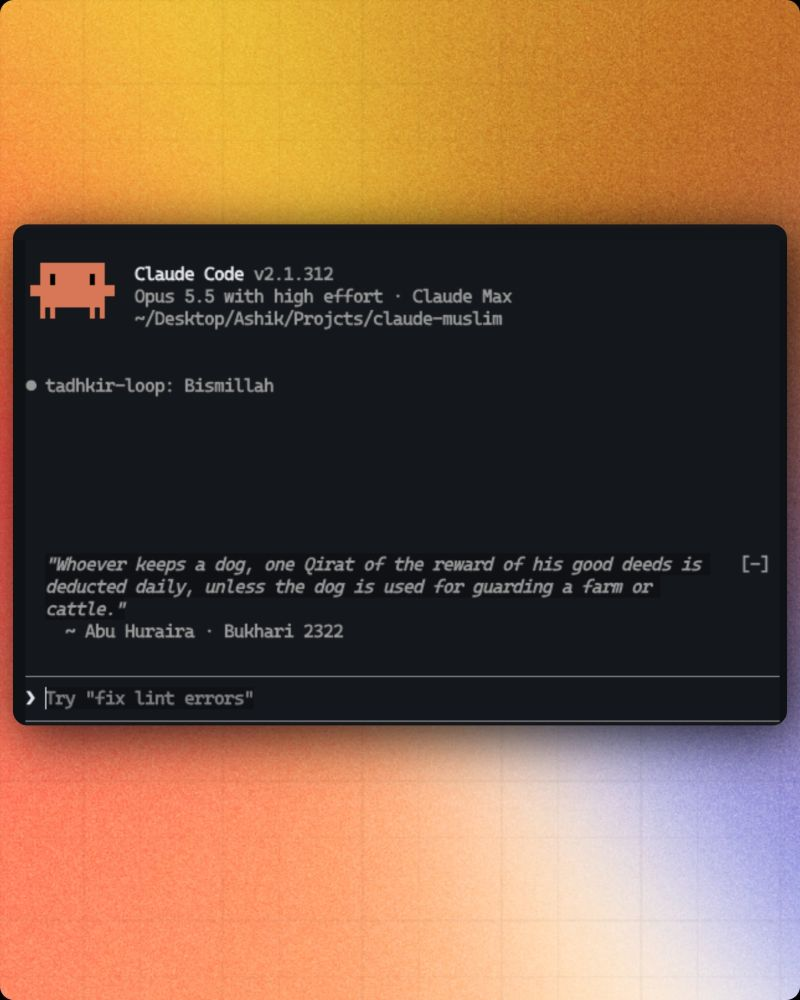

# Tadhkir Loop

<p>
  <a href="https://github.com/Ashikur540/tadhkir-loop/stargazers"></a>
  
  
  
</p>

A Claude Code plugin that turns waiting time into remembrance. While Claude
works, the spinner shows zikr and the 99 names of Allah with their meaning,
and a short authentic hadith sits under it.

## What you see

When you start Claude Code, a Bismillah line, and the hadith of the day just
above the prompt until you send your first message:

<p align="center">
  
</p>

While Claude works, the word changes every 8 seconds, with a hadith for that
turn under it:

```
✻ SubhanAllah · Glory be to Allah… (12s · thinking)

    "Whoever prayed at night the whole month of Ramadan out of sincere Faith
    and hoping for a reward from Allah, then all his previous sins will be
    forgiven."
      ~ Abu Huraira · Bukhari 2009
```

When Claude is done:

```
✻ Alhamdulillah · 41s
```

### In VS Code

The Claude Code panel in VS Code shows the zikr too, with the name of Allah in
color and Claude's sparkling star:

```
From the tadhkir-loop plugin
✻ Al-Muqaddim · The Expediter…
```

VS Code adds the small "From the tadhkir-loop plugin" label itself, so you
always know what changed the screen. You also get a Bismillah line when the
panel opens, and an "Alhamdulillah · 41s" line after each answer. The hadith
under the spinner and the hadith of the day stay in the terminal, because VS
Code puts a frame around anything extra a plugin draws.

## Install

It takes about a minute. You only need Claude Code. You do not need to
download or clone anything yourself.

### Step 1: Check your Claude Code version

Open your terminal and run:

```
claude --version
```

You need **2.1.310 or newer**. If yours is older, run `claude update` first.

### Step 2: Add this plugin's catalog

This tells Claude Code where to find the plugin (this GitHub repo). Run in
your terminal:

```
claude plugin marketplace add Ashikur540/tadhkir-loop
```

### Step 3: Install the plugin

```
claude plugin install tadhkir-loop@tadhkir-loop
```

The first `tadhkir-loop` is the plugin, the one after `@` is the catalog
from Step 2. If it says "2 userConfig options not yet set", that is fine:
both switches are on by default, and you can change them later in `/config`.

### Step 4: Start Claude Code again

Close any Claude Code that is open, then start it again with `claude`. You
should see a **Bismillah** line, and a hadith just above the prompt. Send
any message and watch the spinner.

### Prefer to do it inside Claude Code?

Steps 2 and 3 also work as slash commands inside a running Claude Code:

```
/plugin marketplace add Ashikur540/tadhkir-loop
/plugin install tadhkir-loop@tadhkir-loop
```

Then restart Claude Code, as in Step 4.

### Update to a new version

```
claude plugin marketplace update tadhkir-loop
claude plugin update tadhkir-loop@tadhkir-loop
```

Restart Claude Code to use the new version.

### Remove it

```
claude plugin uninstall tadhkir-loop@tadhkir-loop
claude plugin marketplace remove tadhkir-loop
```

### Not working?

- **Nothing changed after installing:** restart Claude Code. A plugin loads
  when Claude Code starts.
- **Still nothing:** run `claude --version` and make sure it is 2.1.310 or
  newer, then run `claude plugin list` and check that `tadhkir-loop` is there
  and enabled.
- **You use VS Code:** see [In VS Code](#in-vs-code) for what shows there.
  Start a new Claude session after installing; an open one keeps running
  without the plugin.
- **You use the Desktop app:** the zikr does not show there for now. Its
  spinner shows what Claude is really doing ("Creating notes.md"), and the
  zikr would hide that. Plugins do not load in WSL sessions of the Desktop
  app; Claude Code run in a WSL terminal works as normal.
- Still stuck? Open an issue on this repo with your `claude --version` and
  your operating system.

## Settings

Open `/config` and look for Tadhkir Loop:

- **Show hadith**: the hadith under the spinner and the hadith of the day
  card. On by default.
- **Show meaning**: the meaning after each zikr or name. On by default.

For a cleaner look, turn off **Show tips** in `/config`. That hides Claude
Code's own tip line, which otherwise sits between the spinner and the hadith.

In a narrow window the plugin makes room on its own: the meaning is left out
when the line would wrap, and the hadith under the spinner is hidden when the
window is narrower than 60 columns.

## What is inside

- 12 zikr, written in English letters, with their meaning
- The 99 names of Allah, with their meaning
- 26 hadith from Sahih al-Bukhari, each checked by hand against
  [sunnah.com](https://sunnah.com)

Every hadith shows its narrator and its number, so you can read it in full
on sunnah.com, for example `https://sunnah.com/bukhari:2446`.

## Safety

- No network requests. All content ships inside the plugin.
- Reads only its own content file. It never reads your project files.
- No telemetry. It collects nothing about you.
- No third-party code at runtime.

Claude Code plugins can run code on your machine, so only install ones you
trust. You can check what this one does yourself: after Step 2, run
`claude plugin validate ~/.claude/plugins/marketplaces/tadhkir-loop`. Its
`calls:` line lists only `$.clock` (timing), `$.ui` (drawing) and
`$.session.surfaces` (whether you are in the terminal or VS Code), with no
file, shell or network access.

## How it is built

Small on purpose: about 200 lines of plain JavaScript and one content file.

- **`hooks/register.js`** listens to Claude Code's turn events. When a turn
  starts it picks a random starting word and a hadith, then a timer swaps the
  word every 8 seconds. Turns started by sub-agents are ignored, so a helper
  task finishing early never stops the main spinner.
- **`hooks/picker.js`** holds the pure logic: which word to show at a given
  second, the hadith of the day (same for everyone on the same date), and
  fitting the line to a narrow window. Pure functions, so they are easy to test.
- **`data/content.js`** ships all zikr, names and hadith inside the plugin.
  Nothing is fetched while you work.
- **`tools/`** is the content workshop, run by hand only.
  `fetch-candidates.js` pulls hadith and the 99 names from public sources,
  `extract.js` keeps only short, direct sayings of the Prophet (ﷺ), and
  `review.html` is a small page where a person approves each one. No hadith
  gets in without a human check.

Tests live next to the code (`*.test.ts`) and run from the repo folder with:

```
claude plugin test .
```

## Content sources and credits

- Hadith text: [fawazahmed0/hadith-api](https://github.com/fawazahmed0/hadith-api).
  The English translation of Sahih al-Bukhari is by **Muhammad Muhsin Khan**.
- Hadith numbers and links: [sunnah.com](https://sunnah.com).
- The 99 names: [aladhan.com](https://aladhan.com/asma-al-husna-api), with
  spelling and meaning edited by hand.

## Suggest a hadith or report a mistake

Open an issue with the sunnah.com link of the hadith and what you would like
changed. Mistakes in religious text are taken seriously and fixed first.

## Like it?

If Tadhkir Loop helps you, please give the repo a star. It helps other
Muslim developers find it.

## License

The code is under the [MIT License](LICENSE). The license covers the code
only, not the bundled hadith translations or other quoted text, which belong
to their translators and sources above.
